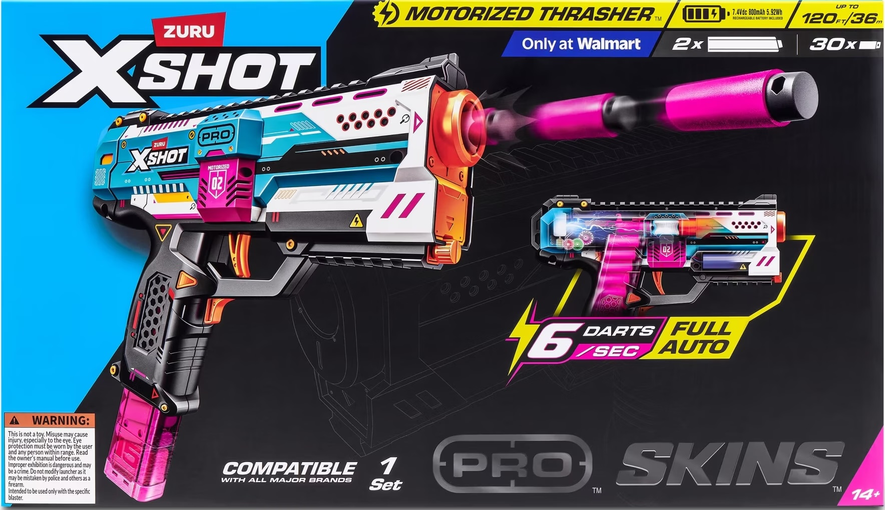

# Products Used

## The gun

[ZURU Xshot Motorized Thrasher (from Walmart)](https://www.walmart.com/ip/XSHOT-SKINS-Pro-Series-Motorized-Thrasher-by-ZURU-Outdoor-Blaster-with-30-Darts-for-Ages-14/18893214387?classType=REGULAR&athbdg=L1100&from=/search)

We purchased this because it was the only electric model available at Walmart at the time. The one other option was not stocked.

## The Screen

[3.5inch TFT LCD](https://www.amazon.com/dp/B0BJDTL9J3)

This is a pretty standard RasPi display, our particular model is from Hosyond. We paid $17.99 for the unit.

# The Mic

[USB stud mic](https://www.amazon.com/dp/B0CYM618H7)

This mic does not have a cord attached, mostly for price. We planned to mount the raspi with the display in front of the face, so were not concerned about reach. We paid $9.59 for a 2-pack. They came in a packaging designed to hold one unit.

The Amazon listing does not provide sample rate information, but when we received them, we checked with `arecord` and the mics support 44.1 and 48 khz.

# The Relays

[5v activated DC 30V/10A Relays](https://www.amazon.com/dp/B095YD3732?th=1)

We used these because Ari has used them in the past, and they are relatively cheap. We paid $6.99 for 4 units.
