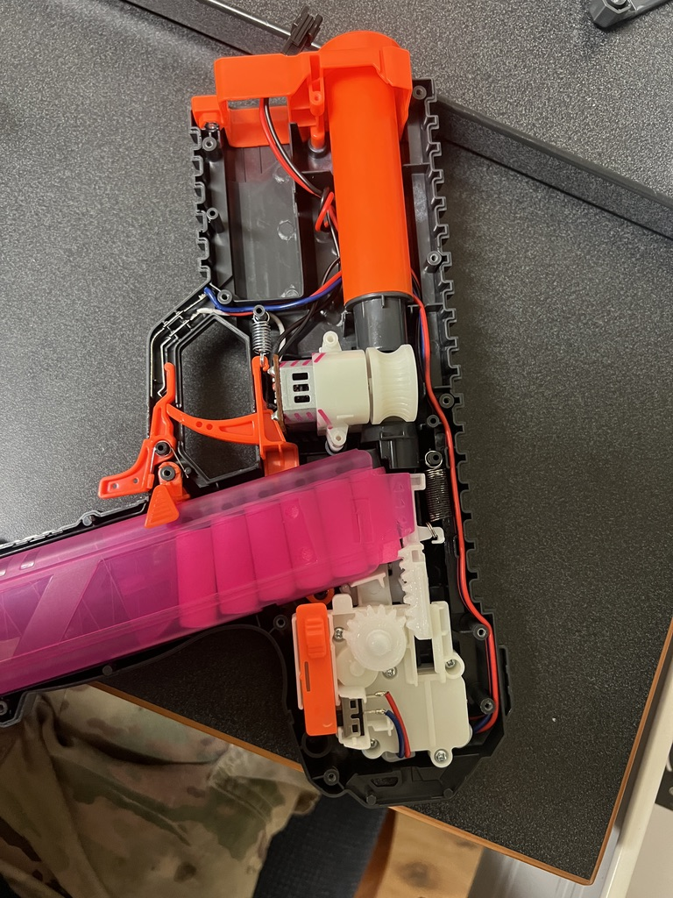
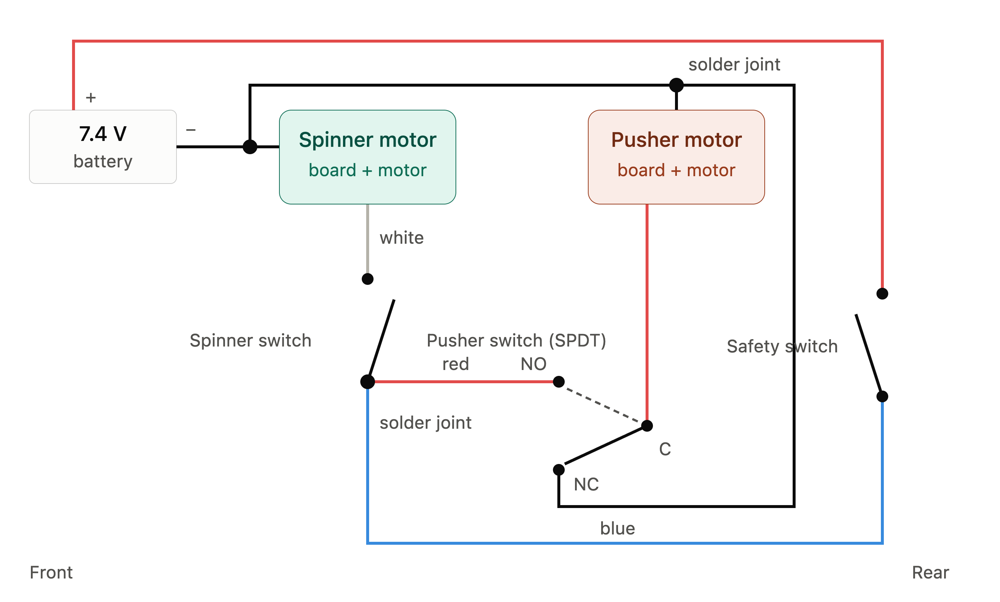
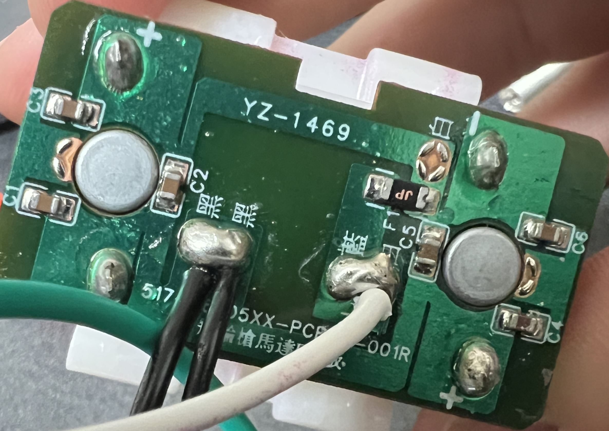

# Process

## The Hardware

We purchased a zuru Xshot "Motorized Thrasher" from Walmart.

After familiarizing ourselves with the controls, we removed approximately a dozen screws to open the clamshell, which was not held together with adhesive or clasps. Inside were three switches and several motors. We took the time to create a circuit diagram, because although it was mostly simple, what we dubbed the "pusher" motor was connected to both the normally open and the normally closed leads of a switch, which created an apparent open between the two sides. Through research, we found an anecdote that this helps slow down the motor faster when switched off. Because the battery is 7.4 volts, and the motors pull several amps (4-6A on startup, with sustained 2A for just the spinner motors and approximately 2.5A with both the spinner motor and the pusher motor running), we determined that we would need relays to switch the leads.

At some point in the process, the pusher motors stopped turning. They would start when supplied with power, but would stop after less than a second. To make a long story short, after hours of debugging, we desoldered and resoldered the component marked JP, with silkscreen F1 (according to a Claude debugging session, this is likely intended to be a series filter inductor to avoid motor noise affecting the rest of the system, and JP is likely just a jumper). After resoldering the component, the board worked as intended and the motors spun as intended when power was applied across its input pads.

We created a schematic detailing the layout with the relays, and soldered on jumpers where necessary. Note that at the pusher motor switch, NC (normally closed; Responsible for the braking effect mentioned earlier) has been desoldered from ground, and now passes through a relay's C (common) terminal to

<!--TODO: Explain this briefly - why this works to create parallel systems that will not create a short (pretty self explanatory, but should be explained) -->

<!--TODO: Explain why the problem still exists of the pusher motor getting power without the spinner motors getting power -->

<!--TODO: Rewire so that pusher motor only gets power if the spinner motors are getting power -->

