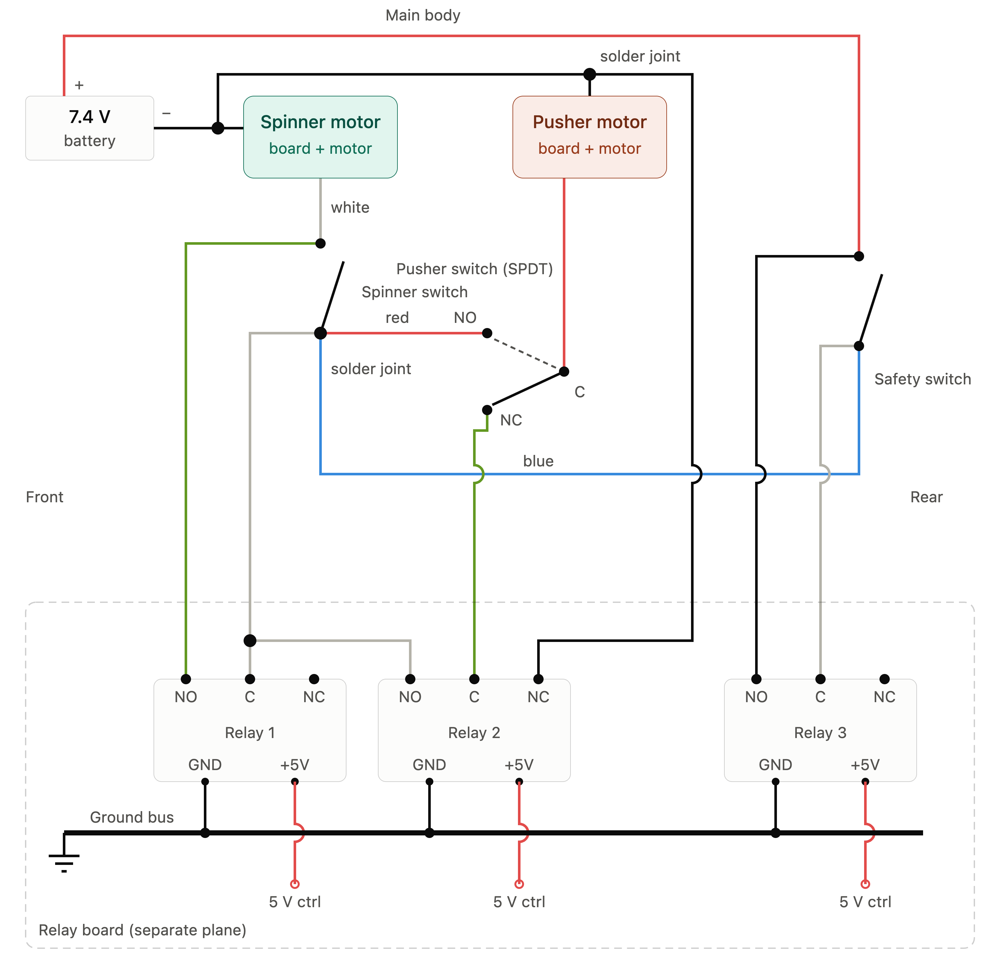
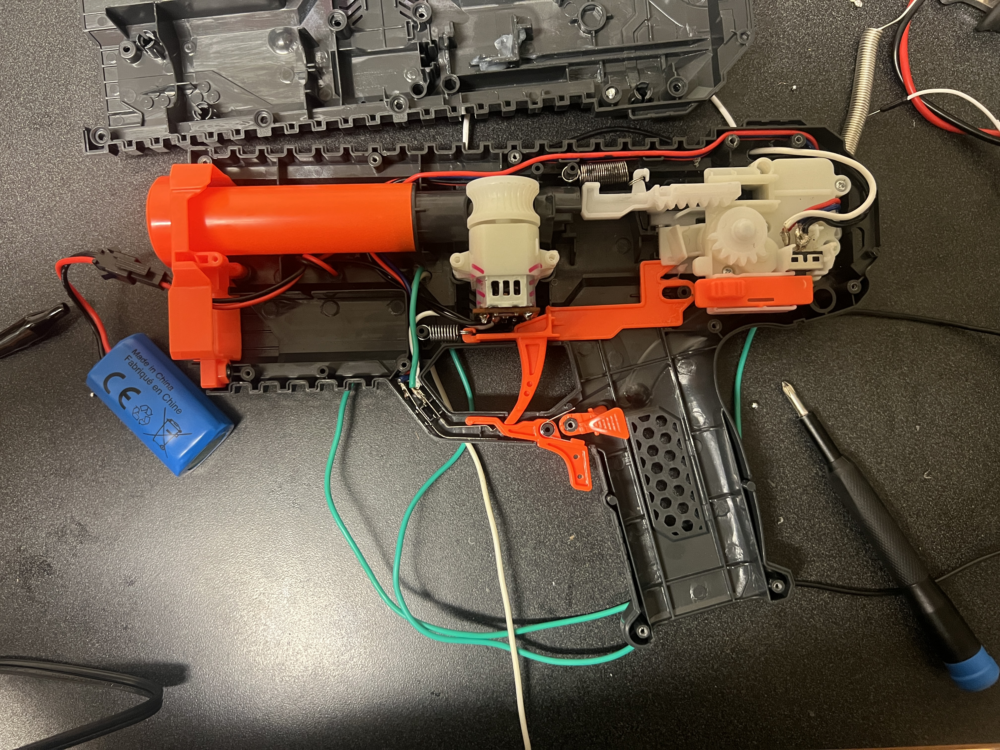
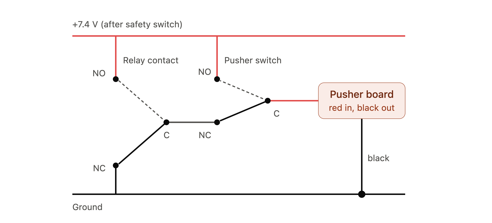

# Process

## The Hardware

We purchased a zuru Xshot "Motorized Thrasher" from Walmart.

After familiarizing ourselves with the controls, we removed approximately a dozen screws to open the clamshell, which was not held together with adhesive or clasps. Inside were three switches and several motors. We took the time to create a circuit diagram, because although it was mostly simple, what we dubbed the "pusher" motor was connected to both the normally open and the normally closed leads of a switch, which created an apparent open between the two sides. Through research, we found an anecdote that this helps slow down the motor faster when switched off. Because the battery is 7.4 volts, and the motors pull several amps (4-6A on startup, with sustained 2A for just the spinner motors and approximately 2.5A with both the spinner motor and the pusher motor running), we determined that we would need relays to switch the leads.

At some point in the process, the pusher motors stopped turning. They would start when supplied with power, but would stop after less than a second. To make a long story short, after hours of debugging, we desoldered and resoldered the component marked JP, with silkscreen F1 (according to a Claude debugging session, this is likely intended to be a series filter inductor to avoid motor noise affecting the rest of the system, and JP is likely just a jumper). After resoldering the component, the board worked as intended and the motors spun as intended when power was applied across its input pads.

We created a schematic detailing the layout with the relays, and soldered on jumpers where necessary. Note that at the pusher motor switch, NC (normally closed; Responsible for the braking effect mentioned earlier) has been desoldered from ground, and now passes through a relay's C (common) terminal to

<!--TODO: Explain this briefly - why this works to create parallel systems that will not create a short (pretty self explanatory, but should be explained) -->

<!--TODO: Explain why the problem still exists of the pusher motor getting power without the spinner motors getting power -->

<!--TODO: Rewire so that pusher motor only gets power if the spinner motors are getting power -->

## The Software

### PocketSphinx

Pocketsphinx initial install went smoothly. We did have to separately install PortAudio, which was not in the initial instructions we followed, but that information is available in the docs. We also had to configure an adapter from the [USB mic's](Products/products.md#the-mic) 44+khz to PocketSphinx's expected 16khz in the [~/.asoundrc file](https://github.com/Cicada330156/2026F-Computer_architecture-Final_Project/commit/fc6392ce746a88b3e099bfd20c49b9af966e1481).

### The Display

[The display](Products/products.md#the-screen) came with a card linking to [their website](https://hosyond.com/), which contained [driver install instructions](https://special-watercress-61d.notion.site/3-5inch-RPi-Display-2a9108be7df181468273ebd1d8175039) that recommended using [https://github.com/goodtft/LCD-show.git](https://github.com/goodtft/LCD-show.git). We used a series of ChatGPT sessions to debug issues, which it summarizes as:

> The Raspberry Pi 3's Hosyond 3.5-inch ILI9486 display initially failed to initialize correctly because the legacy LCD-show installation used outdated configuration settings, disabled KMS, and did not properly install or load the required TFT device-tree overlay. We corrected the SPI and display-driver configuration, enabled the `tft35a` overlay, and confirmed that the kernel recognized the LCD through the `fb_ili9486` driver, creating a 480×320 framebuffer alongside the HDMI framebuffer. We then investigated mirroring the Wayland desktop onto the LCD using framebuffer copying, screenshots with `grim`, and `wl-mirror`, but screenshot capture took approximately 2.5 seconds per frame, making it impractical for responsive mirroring. Instead, we switched to direct framebuffer output, verified that RGB565 pixel data could be written to the LCD, and developed a working Python program using Pillow and NumPy to draw custom graphics independently of the desktop. Finally, we [] implemented automatic LCD framebuffer detection by searching `/sys/class/graphics/` for the `fb_ili9486` driver, avoiding reliance on a framebuffer number that can change between boots.

The site also provided OS versions with built-in drivers, which we initially did not use because we already had an OS installed, though we ended up reinstalling it (the one without a driver) when the initial failed install attempt bricked all display outputs and SSHing in was not attainable.
